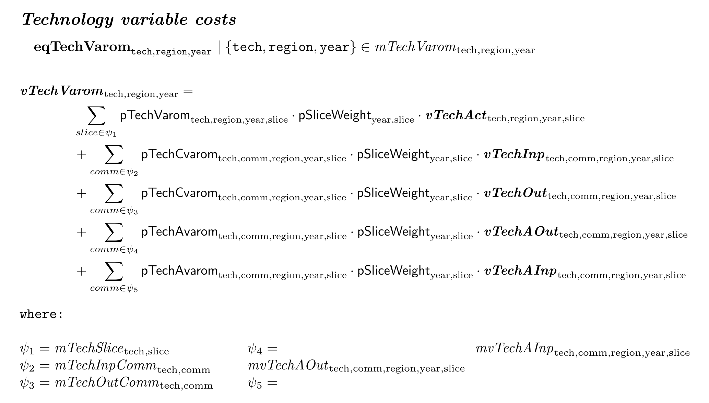
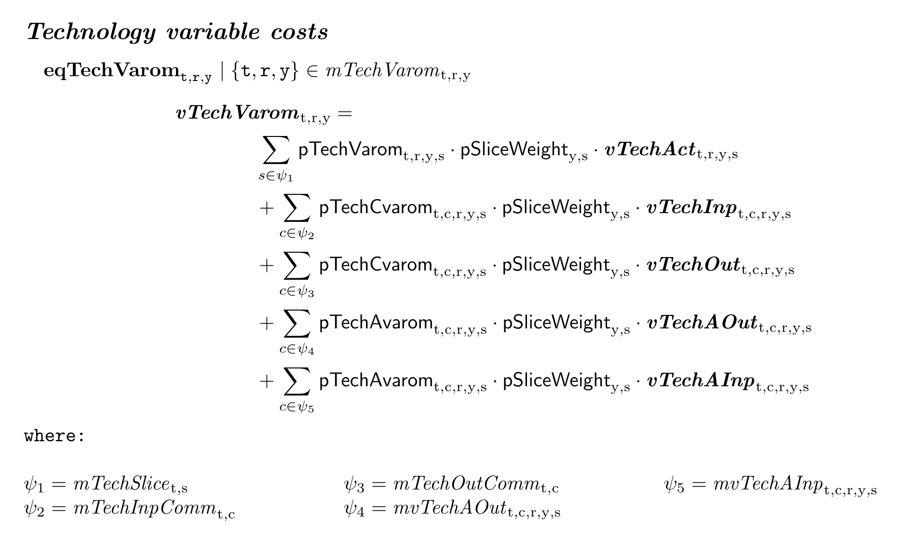
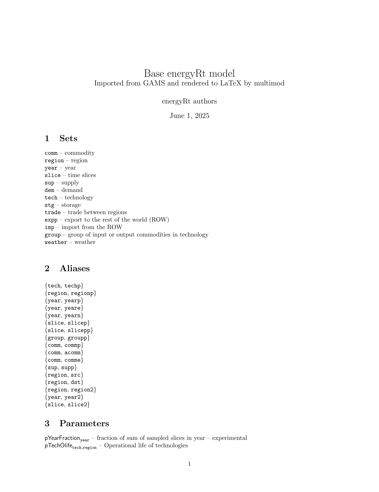

# multimod

multimod stores an optimization model as an abstract syntax tree — sets,
mappings, parameters, variables and equations — independent of any
modeling language. A model becomes coupled to the language it was first
written in; multimod separates three concerns: the model’s *meaning*
(the AST), its *representation* (LaTeX, executable code in another
language, JSON, or a sparse LP matrix) and its *execution* (a local
solver, an institutional modeling environment, or remote hardware). That
separation lets one formulation be compared across backends, documented
as the exact model being solved, manipulated before execution, and
reused across solver ecosystems.

A model enters in three ways: written in R with the constructors,
written as MathProg, GAMS or JuMP text with
[`mm_equation()`](https://optimal2050.github.io/multimod/reference/mm_equation.md),
or read from an existing GAMS or MathProg source. It leaves as rendered
code for GAMS, MathProg, JuMP or Pyomo, as a LaTeX formulation, or as
the LP matrix multimod assembles and solves in R with HiGHS. This
vignette walks through that representation and what the package does
with it.

Linear programs with continuous variables are the tested class. Integer
and binary variables are carried in the AST and written by the JuMP and
Pyomo writers; nonlinear expressions have AST nodes but no tested route
to a solver. The
[roadmap](https://optimal2050.github.io/multimod/articles/roadmap.html)
lists the limitations in full.

## Installation

Install the development version from GitHub with the `pak` package:

``` r

# install.packages("pak")
pak::pkg_install("optimal2050/multimod", dependencies = TRUE)
```

The matrix route needs only the ‘highs’ package. The GLPK route’s
`glpsol` binary ships with the ‘glpsol’ package; Julia with JuMP and
Python with Pyomo are configured as described in the “Configuring solver
paths” article.

## Setup

``` r

library(multimod)
```

## Example model

The package ships the GAMS source of the energyRt model in
`example_models`, both as text and as an already converted `multimod`
object.

``` r

gams_source <- example_models$energyRt$gams$model
```

## Parse model structure

Model structure is a named list of the model symbols: sets, parameters,
variables, equations, and other components. The parser reads
declarations to further identify the model elements used in
equations/constraints. Data and operations on data are not imported–the
parser focuses on the model structure, which is stored in an object of
class `model_structure`.

``` r

mod_str <- read_gams(file_or_text = gams_source, include = FALSE, verbose = FALSE)
print(mod_str)
```

## Convert to multimod

The `model_structure` object can be converted to a `multimod`, either
equation by equation or all at once. The multimod’s `model` class is a
structured representation of the model using the Abstract Syntax Tree
(AST) format. Every element of a model, including operators, variables,
sets and parameters, is represented as an AST node.

``` r

# (Optional) Collect all symbols
symbols <- build_symbols_list(mod_str)
# analyze an equation
ast_node <- parse_gams_equation(mod_str$equations[["eqObjective"]], symbols)
ast_node
```

### Abstract Syntax Tree (AST)

AST nodes are the building blocks of multimod equations, creating a
nested structures.

``` r

lobstr::tree(ast_node, max_length = 25, max_depth = 5)
```

### Visualization

They can be visualized as a tree structure, which is useful for
understanding the relationships between different elements in the model.

``` r

as_visNetwork(ast_node)
```

## Convert to multimod `model` object

The `as_multimod` method applied converts the entire model into a
multimod object, which contains lists of sets, parameters, variables,
equations, represented via AST nodes.

``` r

mod <- as_multimod(mod_str)
print(mod)
```

    #> Model: 
    #> Source:  C:/Users/admin/Documents/R/energyRt/gams/energyRt.gms 
    #> Language:  GAMS 
    #> Sets:  27 
    #> Mappings:  324 
    #> Aliases:  7 
    #> Parameters:  218 
    #> Variables:  93 
    #> Equations:  153

Equations are stored in `$equations` list, and can be accessed by their
names. Each equation is an object of class `equation`, which contains
the left-hand side (LHS) and right-hand side (RHS) expressions and
relation operator.

``` r

eq <- mod$equations$eqTechCap
print(eq)
#> <AST equation> eqTechCap
#>   domain:  mTechSpan[tech,region,year] 
#>   relation:  == 
#>   lhs:  vTechCap[tech,region,year] 
#>   rhs:  vTechStockCap[tech,region,year] + sum(if (mTechNew...
```

``` r

as_visNetwork(eq)
```

## LaTeX rendering

The `as_latex` function converts the multimod equation or AST node into
LaTeX format. The LaTeX output is a string that can be printed or saved
to a file.

``` r

eq$lhs # LHS of the equation - a variable
#> <AST variable> vTechCap
#>   dims:  [tech,region,year]
```

Convert to character

``` r

as.character(eq$lhs)
#> [1] "vTechCap[tech,region,year]"
```

Convert to LaTeX string

``` r

as_latex(eq$lhs) |> cat()
#> \bm{\mathit{vTechCap}}_{\texttt{tech},\texttt{region},\texttt{year}}
```

Render the entire equation

``` r

as_latex(eq) |> cat()
#> \begin{flushleft}
#> \subsection*{\textbf{eqTechCap} -- \textit{Technology capacity}} 
#> \quad$\textbf{eqTechCap} 
#> _{\texttt{tech},\texttt{region},\texttt{year}}$ 
#> $\mid\left\{\texttt{tech},\texttt{region},\texttt{year}\right\} \in \mathit{mTechSpan}_{\texttt{tech},\texttt{region},\texttt{year}}$ \\
#> \begin{equation*}
#> \begin{adjustbox}{max width=\textwidth}
#> $\begin{aligned}
#> &\bm{\mathit{vTechCap}}_{\texttt{tech},\texttt{region},\texttt{year}} = \\
#> &\qquad\qquad  \bm{\mathit{vTechStockCap}}_{\texttt{tech},\texttt{region},\texttt{year}} \\
#> &\qquad\qquad  +   \sum_{yearp \mid \Biggl[ \mathit{mTechNew}_{\texttt{tech},\texttt{region},\texttt{yearp}}  \land  \mathsf{ordYear}_{\texttt{year}}  \geq  \mathsf{ordYear}_{\texttt{yearp}}  \land  \Bigl[ \mathsf{ordYear}_{\texttt{year}}  <  \mathsf{pTechOlife}_{\texttt{tech},\texttt{region}}  +  \mathsf{ordYear}_{\texttt{yearp}}  \lor  \mathit{mTechOlifeInf}_{\texttt{tech},\texttt{region}} \Bigr] \Biggr]} \mathsf{pPeriodLen}_{\texttt{yearp}}  \cdot  \bm{\mathit{vTechNewCap}}_{\texttt{tech},\texttt{region},\texttt{yearp}}  -  \sum_{yeare \mid \Bigl[ \mathit{mvTechRetiredNewCap}_{\texttt{tech},\texttt{region},\texttt{yearp},\texttt{yeare}}  \land  \mathsf{ordYear}_{\texttt{year}}  \geq  \mathsf{ordYear}_{\texttt{yeare}} \Bigr]} \bm{\mathit{vTechRetiredNewCap}}_{\texttt{tech},\texttt{region},\texttt{yearp},\texttt{yeare}}  \cdot  \mathsf{pPeriodLen}_{\texttt{yeare}} \\
#> \end{aligned}$
#> \end{adjustbox}
#> \end{equation*}
#> \vspace{1em}
#> \end{flushleft}
```

Saving an equation to a tex file can be done using the `write_latex`
method. This method can be applied to the entire multimod object, or to
a specific equation.

``` r

eq <- mod$equations$eqTechCapUp
eq_tex_file <- paste0("tmp/", eq$name, ".tex")
write_latex(eq, file = eq_tex_file)
tinytex::pdflatex(eq_tex_file)
```

The `as_latex` and `write_latex` methods for equations are aiming for
formatting the latex output to fit the equation to the page width and
improve readability. Long equations are broken into multiple lines, and
long conditional expressions are remapped with AST `where` class and
display the replacement under the equation under `where` header.

``` r

eq <- mod$equations$eqTechVarom
eq_tex_file <- paste0("tmp/", eq$name, ".tex")
write_latex(eq, file = eq_tex_file)
tinytex::pdflatex(eq_tex_file)
```



### Replacing long names with aliases

There is also an option to replace long names of any simbols with
shorter aliases by using `alias_map` argument in `as_latex` or
`write_latex` methods. The aliases are defined as a named list, where
the names are the original symbols and the values are the shorter
aliases.

``` r

# Example of using aliases in LaTeX rendering
alias_map <- list(
  region = "r", 
  comm = "c", 
  commp = "cp", 
  tech = "t", 
  year = "y",
  timeslice = "s"
)
# eq <- mod$equations$eqTechVarom # the same equation as above
eq_tex_file <- paste0("tmp/", eq$name, "_short.tex")
write_latex(eq, file = eq_tex_file, alias_map = alias_map)
tinytex::pdflatex(eq_tex_file)
```



### Render full model to LaTeX

The `write_latex` method can be applied to the multimod `model` object
to export the entire model to LaTeX format. This will create a LaTeX
file with all equations, sets, aliases, parameters, and variables.

``` r

write_latex(mod, file = "tmp/example_model.tex", 
            title = "Base energyRt model",
            subtitle = "Imported from GAMS and rendered to LaTeX by multimod",
            author = "energyRt authors",
            alias_map = mod$index_aliases)
tinytex::pdflatex("tmp/example_model.tex")
```



## Rendering back to GAMS

The idea of the `multimod` package is to provide a way to convert the
model structure back to GAMS, Julia/JuMP, Python/Pyomo, or other
mathematical programming languages. The `as_gams` method converts a
multimod object or equation back to GAMS code;
[`write_gams()`](https://optimal2050.github.io/multimod/reference/write_gams.md)
renders the whole model to a `.gms` file and
[`write_gams_data()`](https://optimal2050.github.io/multimod/reference/write_gams_data.md)
exports the data as a GDX.

``` r

as_gams(mod$equations$eqTechCapUp) |> cat()
#> eqTechCapUp[tech,region,year]$mTechCapUp[tech,region,year]..
#>   vTechCap[tech,region,year] =l=
#>   pTechCapUp[tech,region,year];
```

Render the full model and its data.

``` r

write_gams(mod, file = file.path(tempdir(), "example_model.gms"))
write_gams_data(mod, file = file.path(tempdir(), "example_model.gdx"))
```

## Routes to a solver

A model with data attached can be solved two ways. The matrix route
assembles the LP in R:
[`model_to_lp()`](https://optimal2050.github.io/multimod/reference/model_to_lp.md)
builds the coefficient matrix from the equations,
[`solve_highs()`](https://optimal2050.github.io/multimod/reference/solve_highs.md)
solves it in process with HiGHS, and
[`mm_session()`](https://optimal2050.github.io/multimod/reference/mm_session.md)
keeps the matrix between repeated solves. The file routes write the
model in another language and run its toolchain:
[`write_gmpl()`](https://optimal2050.github.io/multimod/reference/write_gmpl.md)
with
[`solve_gmpl()`](https://optimal2050.github.io/multimod/reference/solve_gmpl.md)
(GLPK),
[`write_jump()`](https://optimal2050.github.io/multimod/reference/write_jump.md)
with
[`solve_jump()`](https://optimal2050.github.io/multimod/reference/solve_jump.md)
(Julia),
[`write_pyomo()`](https://optimal2050.github.io/multimod/reference/write_pyomo.md)
with
[`solve_pyomo()`](https://optimal2050.github.io/multimod/reference/solve_pyomo.md)
(Python). `example_models$toy` is a small LP to try them on; the website
article “Solving and reading results” takes it through every route, and
“Two models from the field” does the same for the energyRt reference
model and OSeMOSYS.

``` r

r <- solve_highs(example_models$toy, attach = FALSE)
r$objective
```

## Summary

This vignette provides an overview of the current functionality of the
`multimod` package, which allows for parsing certain GAMS models,
converting them into a structured format, rendering to LaTeX, and
converting back to GAMS code. The package is still under development,
not all styles of GAMS models and syntax are supported, more features
will be added in the future. See the [Development
status](https://optimal2050.github.io/multimod/articles/roadmap.md)
article for details.
