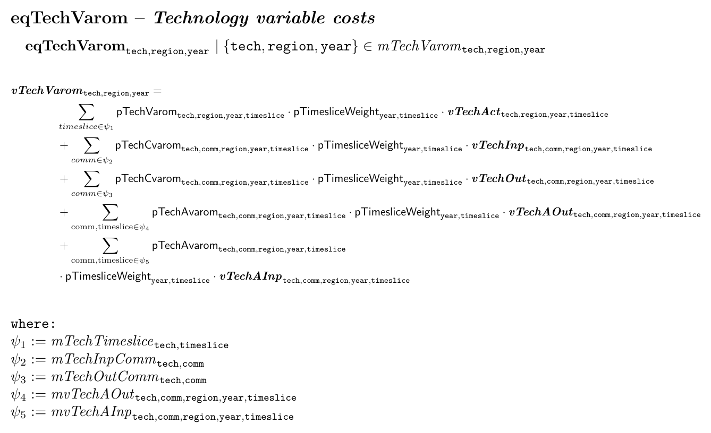

# LaTeX rendering

[`as_latex()`](https://optimal2050.github.io/multimod/r/reference/as_latex.md)
converts an equation or any node of the abstract syntax tree (AST) to
LaTeX;
[`write_latex()`](https://optimal2050.github.io/multimod/r/reference/write_latex.md)
writes an equation or a whole model to a `.tex` file. The examples use
the energyRt model shipped with the package.

``` r

library(multimod)
m <- example_models$energyRt$multimod
eq <- m$equations$eqTechVarom
```

## An equation

``` r

eq$lhs
#> <AST variable> vTechVarom
#>   dims:  [tech,region,year]
as_latex(eq$lhs) |> cat()
#> \bm{\mathit{vTechVarom}}_{\texttt{tech},\texttt{region},\texttt{year}}
```

[`write_latex()`](https://optimal2050.github.io/multimod/r/reference/write_latex.md)
writes the equation as a standalone document. Long equations are broken
into lines, and long conditions are moved below the equation under a
`where` header.

``` r

f <- file.path(tempdir(), "eqTechVarom.tex")
write_latex(eq, file = f)
tinytex::pdflatex(f)
```



## Short index names

`alias_map` replaces set names with shorter indices; the model carries a
set of them in `index_aliases`.

``` r

head(m$index_aliases)
#>      comm    region      year timeslice       sup       dem 
#>       "c"       "r"       "y"       "t"       "u"       "d"
```

``` r

f <- file.path(tempdir(), "eqTechVarom_short.tex")
write_latex(eq, file = f, alias_map = as.list(m$index_aliases))
tinytex::pdflatex(f)
```


## The whole model

Applied to a model,
[`write_latex()`](https://optimal2050.github.io/multimod/r/reference/write_latex.md)
writes sets, aliases, parameters, variables, mappings and equations,
with set members and data sizes. The `include_*` arguments select the
sections; for a folded or trimmed model, `model_view = "full"` marks the
removed parts (see [Model
redundancy](https://optimal2050.github.io/multimod/r/articles/folding.md)).

``` r

f <- file.path(tempdir(), "energyRt.tex")
write_latex(m, file = f, title = "energyRt model",
            subtitle = "rendered to LaTeX by multimod",
            author = "energyRt authors")
tinytex::pdflatex(f)
```


