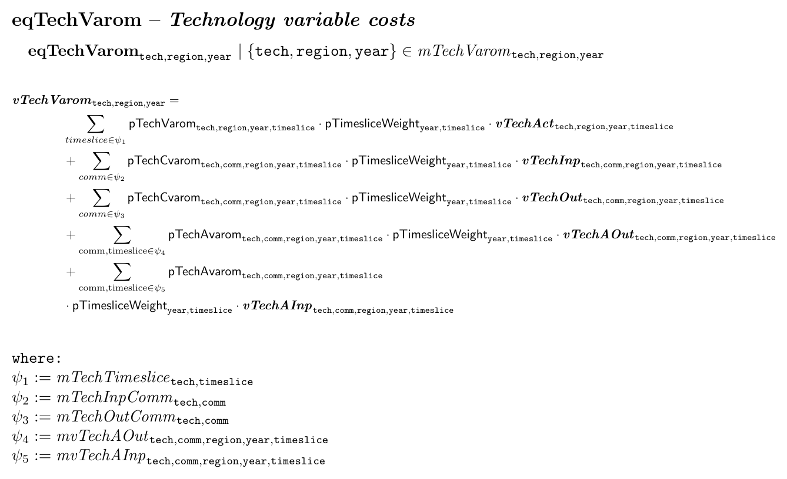
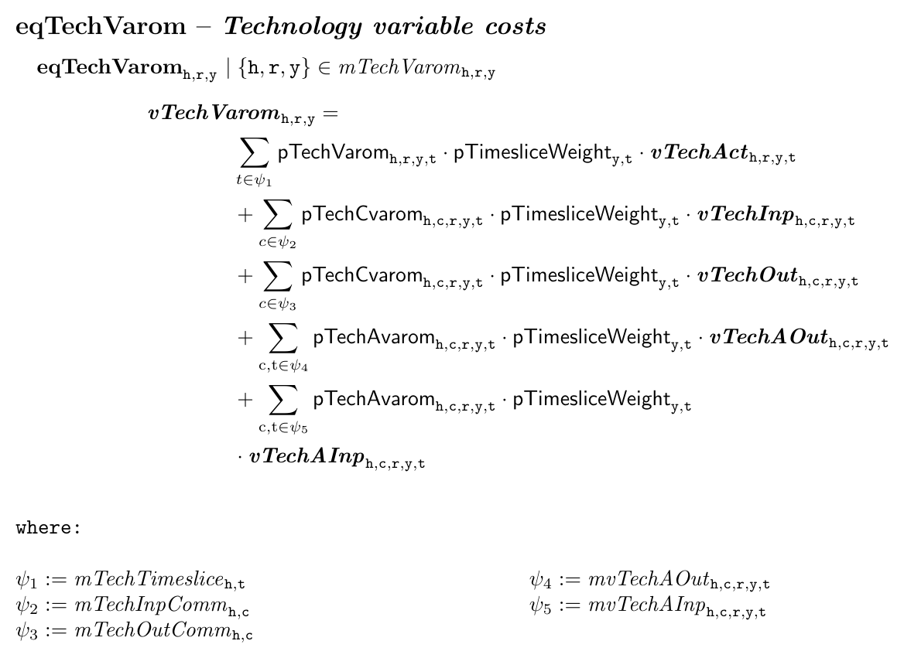
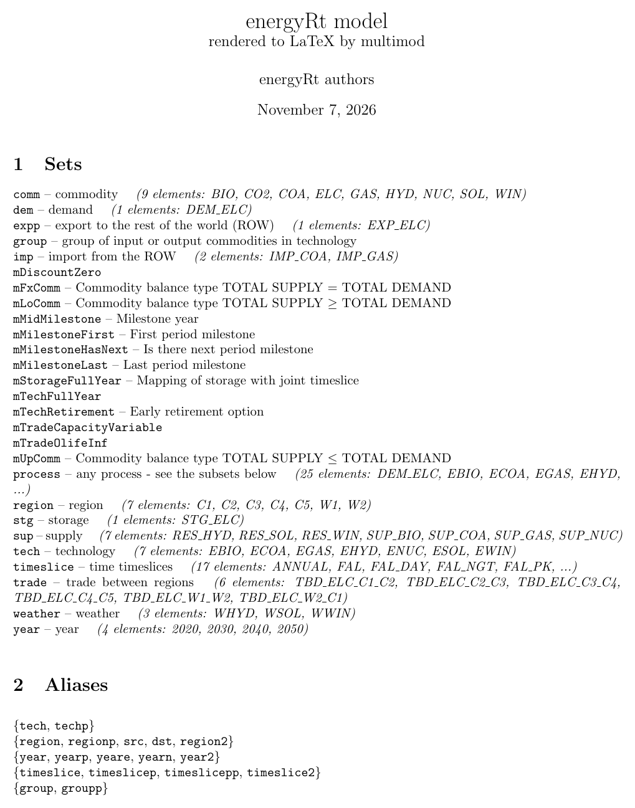

```{r, include = FALSE}
knitr::opts_chunk$set(collapse = TRUE, comment = "#>")
```

`as_latex()` converts an equation or any node of the abstract syntax tree
(AST) to LaTeX; `write_latex()` writes an equation or a whole model to a
`.tex` file. The examples use the energyRt model shipped with the package.

```{r setup}
library(multimod)
m <- example_models$energyRt$multimod
eq <- m$equations$eqTechVarom
```

## An equation

```{r lhs}
eq$lhs
as_latex(eq$lhs) |> cat()
```

`write_latex()` writes the equation as a standalone document. Long equations
are broken into lines, and long conditions are moved below the equation
under a `where` header.

```{r eq-file, eval = FALSE}
f <- file.path(tempdir(), "eqTechVarom.tex")
write_latex(eq, file = f)
tinytex::pdflatex(f)
```

```{r eq-img, echo = FALSE, out.width = "100%", fig.alt = "eqTechVarom compiled to PDF"}

```

## Short index names

`alias_map` replaces set names with shorter indices; the model carries a set
of them in `index_aliases`.

```{r aliases}
head(m$index_aliases)
```

```{r eq-short, eval = FALSE}
f <- file.path(tempdir(), "eqTechVarom_short.tex")
write_latex(eq, file = f, alias_map = as.list(m$index_aliases))
tinytex::pdflatex(f)
```

```{r eq-short-img, echo = FALSE, out.width = "100%", fig.alt = "eqTechVarom with short indices, compiled to PDF"}

```

## The whole model

Applied to a model, `write_latex()` writes sets, aliases, parameters,
variables, mappings and equations, with set members and data sizes. The
`include_*` arguments select the sections; for a folded or trimmed model,
`model_view = "full"` marks the removed parts (see
[Model redundancy](folding.html)).

```{r model-file, eval = FALSE}
f <- file.path(tempdir(), "energyRt.tex")
write_latex(m, file = f, title = "energyRt model",
            subtitle = "rendered to LaTeX by multimod",
            author = "energyRt authors")
tinytex::pdflatex(f)
```

```{r model-img, echo = FALSE, out.width = "80%", fig.alt = "First page of the energyRt model compiled to PDF"}

```

```{r screenshots, eval = FALSE, include = FALSE}
# Regenerates the three images: page 1 of each PDF, footer cut, margins trimmed.
shot <- function(tex, png, density = 200) {
  tinytex::latexmk(tex, engine = "pdflatex")
  img <- magick::image_read_pdf(sub("\\.tex$", ".pdf", tex), density = density)[1]
  info <- magick::image_info(img)
  img <- magick::image_crop(img, paste0(info$width, "x", round(info$height * 0.93), "+0+0"))
  img <- magick::image_border(magick::image_trim(img), "white", "20x20")
  magick::image_write(img, file.path("images", png))
}
d <- tempdir()
write_latex(eq, file = file.path(d, "eqTechVarom.tex"))
shot(file.path(d, "eqTechVarom.tex"), "latex-eqTechVarom.png")
write_latex(eq, file = file.path(d, "eqTechVarom_short.tex"), alias_map = as.list(m$index_aliases))
shot(file.path(d, "eqTechVarom_short.tex"), "latex-eqTechVarom-aliases.png")
write_latex(m, file = file.path(d, "energyRt.tex"), title = "energyRt model",
            subtitle = "rendered to LaTeX by multimod", author = "energyRt authors")
shot(file.path(d, "energyRt.tex"), "latex-model.png", density = 150)
```
