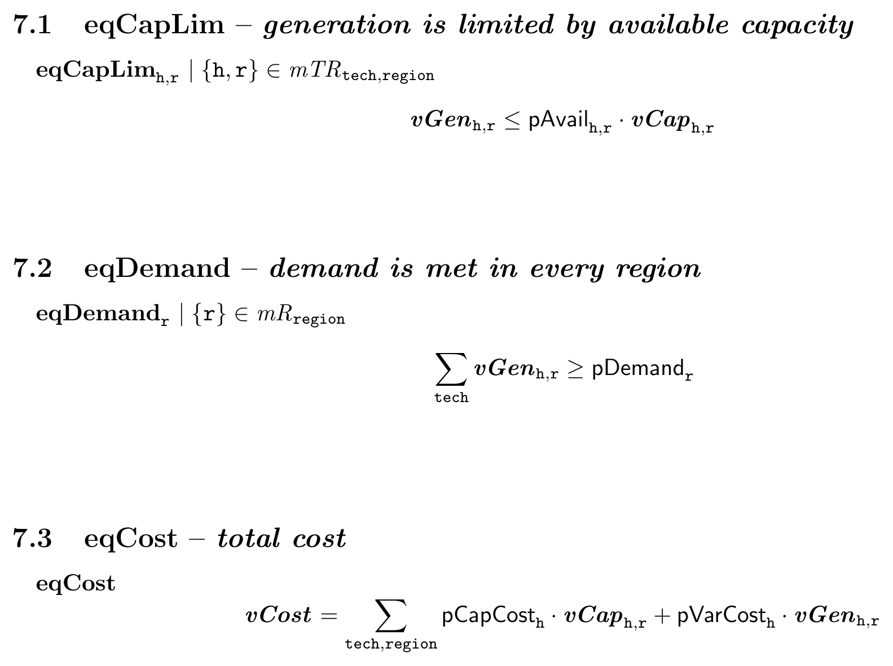

```{r, include = FALSE}
knitr::opts_chunk$set(collapse = TRUE, comment = "#>")
```

```{r setup}
library(multimod)
```

Every node of a model renders as LaTeX with `as_latex()`, and
`write_latex()` assembles a complete document: sets, parameters, variables,
mappings and equations, with the data summarised and the folded or trimmed
parts annotated. The examples use the small model from `vignette("ast")`.

```{r model}
toy <- example_models$toy
```

## Equations and expressions

```{r equation}
as_latex(toy$equations$eqDemand)
as_latex(toy$equations$eqCost$rhs)
```

Index aliases shorten the subscripts. The toy carries them already
(`add_index_aliases()` adds them to a model built in R); `write_latex()`
uses them in equations by default and spells the full set names in the
declarations.

```{r aliases}
unlist(toy$index_aliases)
```

## A document

`write_latex()` returns the LaTeX source as a character vector and, with
`file =`, writes it.

```{r document}
tex <- write_latex(toy)
length(tex)
cat(tex[grep("\\\\section", tex)], sep = "\n")
```

The equations section, one subsection per equation:

```{r equations-section}
i <- grep("subsection\\{\\\\textbf\\{eqDemand", tex)
cat(tex[i:(i + 6)], sep = "\n")
```

Compiled, that is what the reader sees - the same subsections, typeset:

```{r rendered-doc, echo = FALSE, out.width = "100%", fig.alt = "Equations section of the toy model, compiled to PDF"}

```

Arguments select the sections and the amount of data shown:

```{r options}
tex_eq <- write_latex(toy,
  include_sets = FALSE, include_parameters = FALSE,
  include_variables = FALSE, include_mappings = FALSE,
  include_index_aliases = FALSE
)
length(tex_eq)

tex_theory <- write_latex(toy, include_data = FALSE)
length(tex_theory)
```

- `include_data` adds set members and parameter row counts;
  `data_detail = "detailed"` lists more of each.
- `set_display_max_inline`, `set_display_head_tail_threshold`,
  `set_display_head_n` and `set_display_tail_n` control how long sets are
  abbreviated.
- `use_aliases_in_declarations = TRUE` uses the short indices in the
  declarations as well; `alias_map` supplies aliases of your own.
- `include_toc`, `title`, `subtitle` and `author` shape the document;
  `preamble` and `ending` replace the default wrapper.

## Folded and trimmed models

A model that has been through `fold_model()` or `trim_model()`
(`vignette("folding")`) renders in two views. `model_view = "reduced"`, the
default for such a model, shows the model as it will be solved;
`model_view = "full"` shows the original declarations with the folded
parameters marked in `folded_color` and the trimmed symbols in
`trimmed_color`, plus a summary of what folding and trimming did.

```{r trimmed}
m <- example_models$energyRt$multimod
mt <- trim_model(m, verbose = FALSE)
get_trim_summary(mt, format = "text")
tex_full <- write_latex(mt, model_view = "full", trimmed_color = "gray")
sum(grepl("textcolor\\{gray\\}", tex_full))
```

## Compiling

The source compiles with pdflatex or xelatex; it uses amsmath, bm,
hyperref, longtable and xcolor.

```{r compile, eval = FALSE}
write_latex(toy, file = "toy.tex")
system2("pdflatex", "toy.tex")
```

The snapshot above is page 2 of that PDF, regenerated with:

```{r snapshot, eval = FALSE}
write_latex(toy, file = "toy.tex", title = "Model: toy",
            subtitle = "two-region capacity expansion toy model",
            author = "multimod")
tinytex::latexmk("toy.tex", engine = "pdflatex")
page <- magick::image_trim(magick::image_read_pdf("toy.pdf", density = 300)[2])
page <- magick::image_crop(page, paste0(magick::image_info(page)$width, "x1200+0+0"))
magick::image_write(magick::image_border(magick::image_trim(page), "white", "24x24"),
                    "images/toy-latex-rendered.png")
```

Underscores in symbol names are escaped, and `use_latex_names = TRUE`
(the default) renders names such as `pCapCost` in upright math. Set it to
`FALSE` to keep every name verbatim.
